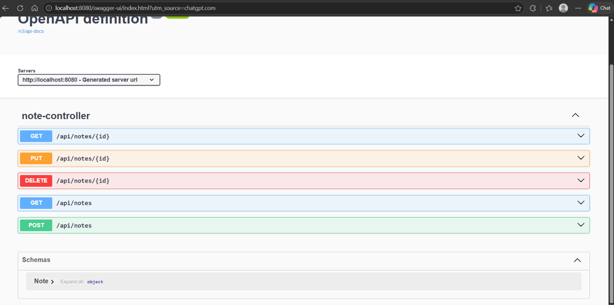

# Notes API

A RESTful Notes Management API developed using Java and Spring Boot as part of my Cognorise internship project.

## Technologies Used
- Java
- Spring Boot
- Spring Data JPA
- MySQL
- Maven
- Swagger UI
- REST API

## Features
- Create a new note
- View all notes
- View a note by ID
- Update an existing note
- Delete a note
- Input validation
- Global exception handling
- API documentation using Swagger UI

## API Endpoints

| Method | Endpoint | Description |
|---|---|---|
| GET | /api/notes | Get all notes |
| GET | /api/notes/{id} | Get note by ID |
| POST | /api/notes | Create a note |
| PUT | /api/notes/{id} | Update a note |
| DELETE | /api/notes/{id} | Delete a note |

## Database
MySQL database: `notes_db`

## Run the Project

1. Clone or download the project.
2. Create a MySQL database named `notes_db`.
3. Configure your database username and password.
4. Set the `EMP_DB_PASSWORD` environment variable.
5. Run the application:

```bash
./mvnw spring-boot:run
```

On Windows PowerShell:

```powershell
.\mvnw.cmd spring-boot:run
```

## Swagger Documentation

After starting the application, open:

http://localhost:8080/swagger-ui/index.html

## Author
Java Internship Project – Cognorise
## Swagger UI Screenshot


